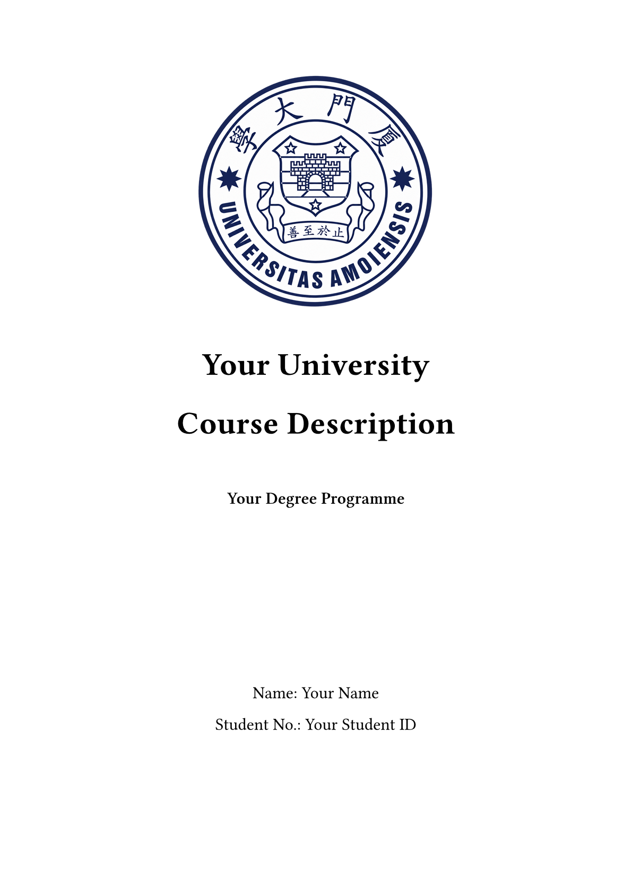
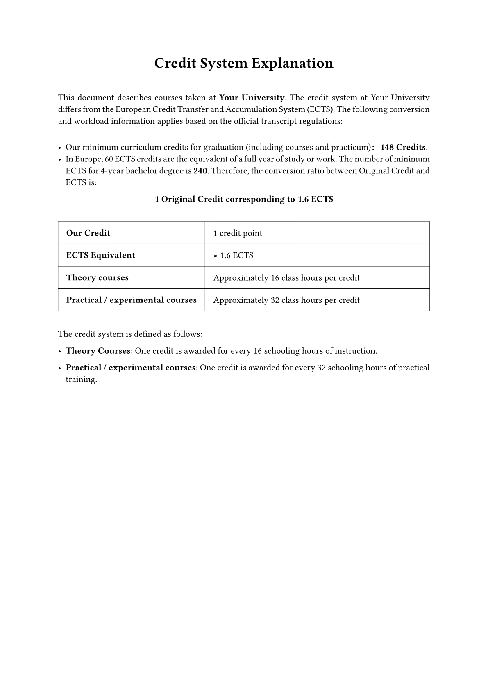
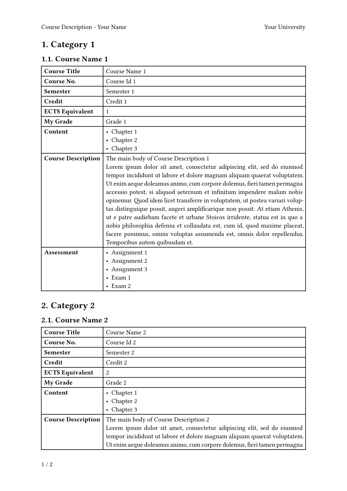

# 课程描述模板 / Course Description Template

本仓库提供了一个 [Typst](https://typst.app/) 课程描述模板，旨在帮助生成清晰专业的课程摘要，适合申请欧陆学校时使用。基于已有模板，此版本主要改动为，将课程内容与课程分类分开保存，方便根据不同项目的申请要求调整模块及课程顺序。

A [Typst](https://typst.app/) course description template for applications to universities in continental Europe. Based on the original templates, main change here is to separate course content from category arrangements, making it easier to reorganize modules and courses for different programmes.

- 修改适用于厦大的学分制度说明。 / Specializes credit-system explanation for XMU.
- 增加了在目录中自动计算课程 ECTS 的功能。 / Auto-calculates course ECTS values in the table of contents.
- 课程内容单独保存，可在申请不同项目时重复使用。 / Stores course records separately for reuse across applications.
- 删除了时间戳脚注。 / Deletes datetime footnotes.

## 预览 / Preview

|  |  |
| ------------------------------------ | ------------------------------------ |
|  |  |

## 使用方法 / Usage

你可以在 [typst.app](https://typst.app/) 导入项目进行在线编辑，也可以使用 [VS Code](https://code.visualstudio.com/) 进行本地编辑（安装 **Tinymist Typst** 插件可获得实时预览功能）。

Import the project into [typst.app](https://typst.app/) for online editing, or edit locally in [VS Code](https://code.visualstudio.com/) with **Tinymist Typst** for live previews.

将以下三个文件放在同一文件夹中，编辑后编译 `main.typ` 即可生成 PDF。

Keep the following three files in the same folder and compile `main.typ` to generate the PDF.

| 文件 / File | 用途 / Purpose |
| --- | --- |
| `main.typ` | 填写个人及院校信息，选择课程并调整分类和顺序。 / Document details, course selection, categories, and order. |
| `template.typ` | 设置版式、目录、学分制度说明及课程表格。 / Layout, contents, credit-system explanation, and course tables. |
| `course.typ` | 保存各门课程的详细信息。 / Reusable course records and descriptions. |

### 元数据 / Metadata

请在 `main.typ` 文件开头填写以下元数据。默认不使用校徽图片；如需校徽，请用注释中的 `cover` 配置替换 `cover: none`，并提供图片文件 `logo.png` 。

Fill in the following metadata at the beginning of `main.typ`. To add a cover logo, replace `cover: none` with the commented configuration and supply the image file `logo.png` .

```typst
#import "template.typ": template, course
#import "course.typ": courses

#show: template.with(
  university: "The name of your University",
  major: "The name of your major",
  school: "The name of your School / Department",
  name: "Your Name",
  id: "Your Student ID",
  cover: none,
  // cover: (
  //   logo_path: "logo.png",
  //   logo_width: 100%,
  //   logo_with_university_name: true,
  // ),
)
```

### 课程分类 / Course Categories

在 `main.typ` 中，使用 `= 课程类别名称` 创建类别，再调用 `course.typ` 中保存的课程。例如：

In `main.typ`, use `= Course Category Name` to create categories, then insert course records from `course.typ`:

```typst
= Major Courses

#course(..courses.course1)
#course(..courses.course2)
```

申请不同项目时，只需调整类别名称及这些调用的位置、顺序或数量，无需重复复制课程描述。

For each application, rename categories and move, reorder, add, or remove these calls without duplicating course descriptions.

### 课程描述项目 / Course Description Items

在 `course.typ` 的 `courses` 字典中填写课程信息，每门课程使用一个独立的键，如 `course1`、`course2`。

Store each course in the `courses` dictionary in `course.typ`, using a unique key such as `course1` or `course2`.

```typst
#let courses = (
  course1: (
    name: [Course Name 1],
    id: [Course ID 1],
    semester: [Semester 1],
    credit: [Credit 1],
    ects: [1],
    hours: [Hours 1],
    grade: [Grade 1],
    preparatory: [Preparatory Course(s) 1],
    content: [
      - Chapter 1
      - Chapter 2
      - Chapter 3
    ],
    description: [
      The main body of Course Description 1 \
      #lorem(100)
    ],
    assessment: [
      - Assignment 1
      - Assignment 2
      - Assignment 3
      - Exam 1
      - Exam 2
    ],
  ),
)
```

继续在字典中添加其他课程即可。`#course` 函数使用命名参数；不需要的字段可以省略，或设为 `none`。例如，上例没有填写 `prerequisite`，表格中就不会显示“先修课程”一行。

Add further records to the dictionary as needed. The `#course` function uses named parameters; omit optional fields or set them to `none` to hide their rows. For example, the record above omits `prerequisite`, so the prerequisite row will not appear.

`ects` 数值需手动填写，不会根据 `credit` 自动换算。请根据本校实际情况修改 `template.typ` 中的学分制度说明。公开仓库中请保留示例信息，含个人信息的版本另行保存。

ECTS values are entered manually rather than calculated from `credit`. Update the credit-system explanation in `template.typ` to match your institution. Keep sample data in the public repository and store personal application versions privately.

## 致谢 / Acknowledgements

感谢以下项目及作者的开源贡献,请给他们点star。本版本仅在既有模板基础上作了少量结构调整。

Thanks to the following projects and authors, please star them. This version only makes some small structural changes to the existing template.

- [dsyislearning / typst-course-description-template](https://github.com/dsyislearning/typst-course-description-template)
- [wawaup / TJU-Course-Description-Template](https://github.com/wawaup/TJU-Course-Description-Template)
